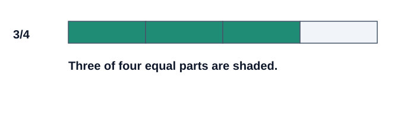
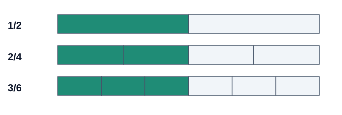
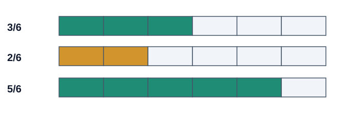
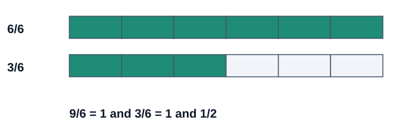

# VibeSchool Originals — Grade 6 Mathematics

**Adding Fractions with Different Denominators**

**Strand:** Numbers · **Sub-strand:** Fractions · **Focus:** Addition using a common denominator and LCM

**Scope:** One complete focused teaching package within the Grade 6 Fractions sub-strand; it is not the entire 12-lesson Fractions programme.

**Contents:** Core lesson (35 minutes, adaptable), four vector fraction diagrams plus one LCM visual chart, eight explained examples, four activities, 63 differentiated practice questions with worked answers, 20 exposed supplementary bank candidates with checks, five-question mastery check, three revision sessions, teacher guide and home support.

> Educational editorial edition. Not automatically connected to the production question bank, curriculum records or learner progress. All visible questions are practice material, not suitable as unseen exams.

## CORE LESSON — LEARN • SEE • TRY • EXPLAIN

### Learning target

By the end of this learning experience, you should be able to explain numerators and denominators, identify equivalent fractions, find a common multiple (usually the LCM), add fractions with unlike denominators, simplify, express totals greater than one, and explain/check your reasoning.

**Success means:** You can solve a fresh problem with clear equivalent-fraction working and explain why your chosen denominator makes sense.

### Think first: Two equal-sized cakes

Amina has **one half** of a cake and Brian has **one third** of another cake of the **same size**. Imagine joining their portions to find how much cake they have altogether.

- Is one half larger than one third?
- Would adding the top and bottom numbers give the correct total?
- Can we divide the two cakes into the same-sized sixths?

### 1. What a fraction tells us

In **3/4**, the numerator **3** counts the selected equal parts. The denominator **4** describes how many equal parts make a whole. The pieces must be equal in size.

**Try:** Draw a rectangle divided into eight equal pieces and shade five. What fraction is shaded? **5/8**.

### 2. Equivalent fractions — the same amount

Equivalent fractions have the same value despite different numbers. Multiply or divide both numerator and denominator by the same non-zero factor.

**1/2 = 2/4 = 3/6**. Each bar below is the same length; the shaded amount is half.

For example, **2/3 = (2×4)/(3×4) = 8/12**. You have not gained or lost any amount by cutting the pieces into more equal parts.

**Quick check:** Which is equivalent to 3/4: 4/6, 6/8 or 3/7? **6/8**, because multiplying top and bottom by 2 gives 6/8.

### 3. Why we need a common denominator

You cannot add a half-piece and a third-piece as though they were pieces of equal size. First describe both using the same-sized parts: **1/2 = 3/6** and **1/3 = 2/6**.

**1/2 + 1/3 = 3/6 + 2/6 = 5/6.**

**Important correction:** A half is **three times** the size of a sixth; a third is **twice** the size of a sixth. One half is not twice a sixth.

### 4. Find the least common multiple

The **LCM** is the smallest positive number divisible by both numbers. For 4 and 6, write the multiples:

| Multiples of 4 | Multiples of 6 |
|:--|:--|
| 4, 8, **12**, 16, ... | 6, **12**, 18, 24, ... |

**LCM(4,6) = 12.** You *can* use a larger common multiple, but 12 gives smaller equivalent fractions.

### 5. Five steps for unlike denominators

1. Find a common denominator (prefer the LCM).
2. Rewrite each fraction as an equivalent fraction over that denominator.
3. Add the numerators.
4. Keep the common denominator.
5. Simplify the fraction; if greater than one, write a mixed number when appropriate.

**Never add original denominators.** The denominator names the size of each equal part.

### Core worked example 1

**Calculate 1/2 + 1/3.**

1. LCM of 2 and 3 is **6**.
2. Convert: **1/2 = 3/6**, **1/3 = 2/6**.
3. Add: **3/6 + 2/6 = 5/6**.
4. Check reasonableness: 5/6 is bigger than one half, yet less than a whole.

### Core worked example 2

**Calculate 3/4 + 1/6.**

1. LCM(4,6) = **12**.
2. **3/4 = 9/12** and **1/6 = 2/12**.
3. **9/12 + 2/12 = 11/12**.
4. Check: we added a positive fraction to 3/4, and the answer is larger than 3/4.

### Core worked example 3 — find the error

**A learner writes 1/2 + 1/3 = 2/5.** This cannot be right: 2/5 is smaller than 1/2 even though a positive amount was added. Use sixths to get **5/6**.

### Core activity: fraction strips

1. Fold or draw three same-length paper strips into 2, 3 and 6 equal sections.
2. Shade half of the first and one third of the second.
3. Compare them with the strip divided into sixths.
4. Explain why three sixths and two sixths join to make five sixths.

### Guided questions (show working first)

1. **1/2 + 1/4 = ?** — **3/4** (2/4 + 1/4).
2. **1/3 + 1/6 = ?** — **1/2** (2/6 + 1/6 = 3/6).
3. **2/3 + 1/4 = ?** — **11/12** (8/12 + 3/12).

### Independent core check

1. Calculate 1/2 + 1/6.
2. Calculate 2/5 + 1/10.
3. Calculate 3/8 + 1/4.
4. Why do we keep the common denominator after adding the numerators?

**Answers:** (1) 2/3, (2) 1/2, (3) 5/8, (4) because the same-sized fractional parts are being counted; the number of parts changes, not their size.

**Exit question:** Explain why 1/4 + 1/6 is 5/12 and not 2/10, using a diagram or words.

---

## SUPPLEMENTARY DEEP-DIVE — SIX MORE WORKED EXAMPLES

Core examples above represent Examples 1, 2 and 8 of the original set. The following deepen the method without overloading one classroom period.

### Example 3 — Convert only the needed fraction

**Question:** 3/8 + 1/4

1. LCM(8,4)=8.
2. 1/4 = 2/8, so 3/8 can stay as it is.
3. 3/8 + 2/8 = 5/8.

**Answer: 5/8.** Avoid unnecessary multiplication when a denominator already fits.

### Example 4 — More demanding denominators

**Question:** 5/12 + 1/8

1. LCM(12,8)=24.
2. 5/12 = 10/24; 1/8 = 3/24.
3. 10/24 + 3/24 = 13/24.

**Answer: 13/24.** Both numerator and denominator are already coprime, so 13/24 is simplest.

### Example 5 — Simplifying correctly

**Question:** 1/2 + 3/10

1. LCM(2,10)=10.
2. 1/2 = 5/10.
3. 5/10 + 3/10 = 8/10; divide top and bottom by 2.

**Answer: 4/5.** 8/10 and 4/5 are equal portions of the same whole.

### Example 6 — A total larger than one

**Question:** 2/3 + 5/6

1. LCM(3,6)=6.
2. 2/3 = 4/6.
3. 4/6 + 5/6 = 9/6 = 1 3/6 = 1 1/2.

**Answer: 1 1/2.** One whole uses 6/6, and the remaining 3/6 is half a whole.

### Example 7 — Interpret a garden problem

**Question:** 2/5 + 1/4 of the same garden

1. Both sections are non-overlapping parts of the same whole.
2. LCM(5,4)=20; 2/5=8/20 and 1/4=5/20.
3. 8/20 + 5/20 = 13/20.

**Answer: 13/20 of the garden.** The wording matters: the areas must not overlap and use the same whole.

### Example 8 — Error detective (review)

1/2 + 1/3 = 2/5 (incorrect)

Change to equal-sized sixths: 1/2=3/6 and 1/3=2/6.
3/6+2/6 = 5/6.

**Answer: 5/6.** The incorrect rule adds denominators; do not add different-sized parts without converting them.

## FOUR PRACTICAL ACTIVITIES

### Activity 1 — Make fraction strips

Use paper, pencil and a ruler. Draw three bars of exactly the same length. Divide them into halves, thirds and sixths. Shade one half and one third on separate strips and combine these on the sixths strip. **Expected:** 3/6 + 2/6 = 5/6.

### Activity 2 — Explore LCM

List multiples to find the LCM of **(2,5), (3,4), (4,6), (6,8), (5,10)**. Explain how you know each is the *least* common multiple. **Answers:** 10, 12, 12, 24, 10.

### Activity 3 — Become the teacher

Solve **2/3 + 1/4** and explain why the LCM is 12, how the numerators change and how you know the sum **11/12** is reasonable. Try an explanation aloud to yourself if learning alone.

### Activity 4 — Fraction detective

Learner A writes **1/2 + 1/4 = 3/4**. Learner B writes **1/3 + 1/2 = 2/5**. Learner C writes **2/3 + 1/6 = 5/6**. Identify who is correct and repair the mistaken method. **Answers:** A and C are correct; B should get **5/6**.

---

## SUPPLEMENTARY PRACTICE — 63 QUESTIONS

**Instruction:** Work through one set at a time. Do not reveal the answer until you have tried the question. Show equivalent-fraction working and simplify. Set E has been corrected: Question 44 now genuinely gives a sum greater than one.

### Set A — Understanding fractions

1. Identify the numerator and denominator in 5/8.
2. Three out of six equal parts of a shape are shaded. Write and simplify the fraction.
3. Express 1/2 in sixths.
4. Express 2/3 in twelfths.
5. Express 3/4 in twentieths.
6. Simplify 6/9.
7. Which is greater: 5/8 or 1/2? Explain.
8. Calculate 3/10 + 2/10.
9. Explain why 1/2 + 1/3 is not 2/5.

### Set B — LCM and equivalent fractions

10. Find the LCM of 2 and 3.
11. Find the LCM of 4 and 6.
12. Find the LCM of 6 and 8.
13. Find the LCM of 5 and 12.
14. Find the LCM of 9 and 12.
15. Find the LCM of 3 and 10.
16. Express 2/5 and 1/4 with denominator 20.
17. Express 5/6 and 1/9 with denominator 18.
18. Can 24 be used as a common denominator for fourths and sixths? Is it the lowest?

### Set C — Foundation additions

19. Calculate 1/2 + 1/6.
20. Calculate 1/3 + 1/9.
21. Calculate 1/4 + 3/8.
22. Calculate 2/5 + 1/10.
23. Calculate 3/7 + 1/14.
24. Calculate 5/12 + 1/6.
25. Calculate 3/8 + 1/4.
26. Calculate 2/9 + 1/3.
27. Calculate 3/10 + 1/5.

### Set D — More demanding denominators

28. Calculate 2/3 + 1/4.
29. Calculate 5/12 + 1/8.
30. Calculate 3/5 + 1/6.
31. Calculate 4/9 + 5/12.
32. Calculate 7/10 + 1/8.
33. Calculate 2/7 + 3/5.
34. Calculate 5/6 + 1/15.
35. Calculate 7/12 + 5/18.
36. Calculate 5/8 + 3/10.

### Set E — Totals greater than one

37. Calculate 2/3 + 5/6.
38. Calculate 3/4 + 2/3.
39. Calculate 5/8 + 3/4.
40. Calculate 5/6 + 7/12.
41. Calculate 7/9 + 5/6.
42. Calculate 11/12 + 3/8.
43. Calculate 4/5 + 7/10.
44. Calculate 5/7 + 5/14.
45. Calculate 5/6 + 3/10.

### Set F — Real-life applications

46. Two non-overlapping sections of the same mural cover 1/3 and 1/4 of its total area. What fraction is covered?
47. Two non-overlapping school-garden sections cover 2/5 and 1/6 of the same garden. What fraction is covered?
48. A journey lasts 1/2 hour and a second journey lasts 3/4 hour. Find their combined duration.
49. A learner mixes 2/3 litre of juice with 1/4 litre of water. How much liquid is there altogether?
50. One container has 3/8 kg of maize and another has 1/6 kg. Find the combined mass.
51. A club uses 1/4 of its budget for books and 2/5 for stationery. What fraction is used and what remains?
52. A learner walks 3/4 km and then 2/3 km more. Find the total distance.
53. A learner reads for 5/12 hour and writes for 1/6 hour. Give the total time in hours and minutes.
54. A jug contains 7/8 litre of water and another 5/12 litre is added. How much water is there?

### Set G — Reasoning and error correction

55. A learner claims 1/2 + 1/3 = 2/5. Explain the mistake and correct it.
56. A learner claims 1/4 + 1/6 = 2/10. Explain why and correct it.
57. Which is greater: 1/2 + 1/4 or 2/3? By how much?
58. Find the missing fraction: 1/3 + □ = 5/6.
59. Find the missing fraction: 3/8 + □ = 7/8.
60. Give two fractions with different denominators whose sum is exactly one.
61. Show that both 6 and 12 can be common denominators for 1/2 + 1/3.
62. A learner finds 2/3 + 1/4 = 11/12. Show two ways to check it.
63. Create a real-life problem adding unlike fractions whose total exceeds one, and explain it.

---

## WORKED ANSWER AND FEEDBACK GUIDE — ALL 63

Every question has a distinct explanation. Answer keys are for guided checking, not an automatically approved exam bank.

### Answers: Set A — Understanding fractions

**1. Numerator 5; denominator 8.** — The numerator counts selected equal parts; the denominator tells how many equal parts form one whole.

**2. 3/6 = 1/2.** — Divide numerator and denominator by 3; the shaded area is half the whole.

**3. 3/6.** — Multiply the top and bottom by 3; the value stays one half.

**4. 8/12.** — Multiply both parts by 4: 2×4 over 3×4.

**5. 15/20.** — Multiply both the numerator and denominator by 5.

**6. 2/3.** — Divide both numerator and denominator by the greatest common factor, 3.

**7. 5/8 by 1/8.** — One half is 4/8. Five eighths is one eighth more.

**8. 1/2.** — The parts already have the same denominator: 5/10 = 1/2.

**9. The correct sum is 5/6.** — Convert both to sixths: 3/6 + 2/6 = 5/6. Adding denominators would change the size of parts.

### Answers: Set B — LCM and equivalent fractions

**10. 6** — 6 is the smallest positive number divisible by both 2 and 3.

**11. 12** — 12 is the smallest positive number divisible by both 4 and 6.

**12. 24** — 24 is the smallest positive number divisible by both 6 and 8.

**13. 60** — 60 is the smallest positive number divisible by both 5 and 12.

**14. 36** — 36 is the smallest positive number divisible by both 9 and 12.

**15. 30** — 30 is the smallest positive number divisible by both 3 and 10.

**16. 8/20 and 5/20.** — Multiply 2/5 by 4/4 and 1/4 by 5/5.

**17. 15/18 and 2/18.** — Multiply 5/6 by 3/3 and 1/9 by 2/2.

**18. Yes, but no: the LCM is 12.** — Both 4 and 6 divide 24; however 12 is a smaller common multiple.

### Answers: Set C — Foundation additions

**19. 2/3** — LCM(2, 6) = 6; 1/2 = 3/6 and 1/6 = 1/6. Add: 3/6 + 1/6 = 4/6; simplify to 2/3.

**20. 4/9** — LCM(3, 9) = 9; 1/3 = 3/9 and 1/9 = 1/9. Add: 3/9 + 1/9 = 4/9; simplify to 4/9.

**21. 5/8** — LCM(4, 8) = 8; 1/4 = 2/8 and 3/8 = 3/8. Add: 2/8 + 3/8 = 5/8; simplify to 5/8.

**22. 1/2** — LCM(5, 10) = 10; 2/5 = 4/10 and 1/10 = 1/10. Add: 4/10 + 1/10 = 5/10; simplify to 1/2.

**23. 1/2** — LCM(7, 14) = 14; 3/7 = 6/14 and 1/14 = 1/14. Add: 6/14 + 1/14 = 7/14; simplify to 1/2.

**24. 7/12** — LCM(12, 6) = 12; 5/12 = 5/12 and 1/6 = 2/12. Add: 5/12 + 2/12 = 7/12; simplify to 7/12.

**25. 5/8** — LCM(8, 4) = 8; 3/8 = 3/8 and 1/4 = 2/8. Add: 3/8 + 2/8 = 5/8; simplify to 5/8.

**26. 5/9** — LCM(9, 3) = 9; 2/9 = 2/9 and 1/3 = 3/9. Add: 2/9 + 3/9 = 5/9; simplify to 5/9.

**27. 1/2** — LCM(10, 5) = 10; 3/10 = 3/10 and 1/5 = 2/10. Add: 3/10 + 2/10 = 5/10; simplify to 1/2.

### Answers: Set D — More demanding denominators

**28. 11/12** — LCM(3, 4) = 12; 2/3 = 8/12 and 1/4 = 3/12. Add: 8/12 + 3/12 = 11/12; simplify to 11/12.

**29. 13/24** — LCM(12, 8) = 24; 5/12 = 10/24 and 1/8 = 3/24. Add: 10/24 + 3/24 = 13/24; simplify to 13/24.

**30. 23/30** — LCM(5, 6) = 30; 3/5 = 18/30 and 1/6 = 5/30. Add: 18/30 + 5/30 = 23/30; simplify to 23/30.

**31. 31/36** — LCM(9, 12) = 36; 4/9 = 16/36 and 5/12 = 15/36. Add: 16/36 + 15/36 = 31/36; simplify to 31/36.

**32. 33/40** — LCM(10, 8) = 40; 7/10 = 28/40 and 1/8 = 5/40. Add: 28/40 + 5/40 = 33/40; simplify to 33/40.

**33. 31/35** — LCM(7, 5) = 35; 2/7 = 10/35 and 3/5 = 21/35. Add: 10/35 + 21/35 = 31/35; simplify to 31/35.

**34. 9/10** — LCM(6, 15) = 30; 5/6 = 25/30 and 1/15 = 2/30. Add: 25/30 + 2/30 = 27/30; simplify to 9/10.

**35. 31/36** — LCM(12, 18) = 36; 7/12 = 21/36 and 5/18 = 10/36. Add: 21/36 + 10/36 = 31/36; simplify to 31/36.

**36. 37/40** — LCM(8, 10) = 40; 5/8 = 25/40 and 3/10 = 12/40. Add: 25/40 + 12/40 = 37/40; simplify to 37/40.

### Answers: Set E — Totals greater than one

**37. 1 1/2** — LCM(3, 6) = 6; 2/3 = 4/6 and 5/6 = 5/6. Add: 4/6 + 5/6 = 9/6; simplify to 1 1/2.

**38. 1 5/12** — LCM(4, 3) = 12; 3/4 = 9/12 and 2/3 = 8/12. Add: 9/12 + 8/12 = 17/12; simplify to 1 5/12.

**39. 1 3/8** — LCM(8, 4) = 8; 5/8 = 5/8 and 3/4 = 6/8. Add: 5/8 + 6/8 = 11/8; simplify to 1 3/8.

**40. 1 5/12** — LCM(6, 12) = 12; 5/6 = 10/12 and 7/12 = 7/12. Add: 10/12 + 7/12 = 17/12; simplify to 1 5/12.

**41. 1 11/18** — LCM(9, 6) = 18; 7/9 = 14/18 and 5/6 = 15/18. Add: 14/18 + 15/18 = 29/18; simplify to 1 11/18.

**42. 1 7/24** — LCM(12, 8) = 24; 11/12 = 22/24 and 3/8 = 9/24. Add: 22/24 + 9/24 = 31/24; simplify to 1 7/24.

**43. 1 1/2** — LCM(5, 10) = 10; 4/5 = 8/10 and 7/10 = 7/10. Add: 8/10 + 7/10 = 15/10; simplify to 1 1/2.

**44. 1 1/14** — LCM(7, 14) = 14; 5/7 = 10/14 and 5/14 = 5/14. Add: 10/14 + 5/14 = 15/14; simplify to 1 1/14.

**45. 1 2/15** — LCM(6, 10) = 30; 5/6 = 25/30 and 3/10 = 9/30. Add: 25/30 + 9/30 = 34/30; simplify to 1 2/15.

### Answers: Set F — Real-life applications

**46. 7/12 of the mural** — Use equal-sized twelfths: 4/12 + 3/12 = 7/12.

**47. 17/30 of the garden** — The LCM of 5 and 6 is 30: 12/30 + 5/30 = 17/30.

**48. 1 1/4 hours = 1 hour 15 minutes** — 2/4 + 3/4 = 5/4 hours. One quarter of 60 minutes is 15.

**49. 11/12 litre** — Convert to 8/12 + 3/12 = 11/12 litre.

**50. 13/24 kg** — The LCM is 24: 9/24 + 4/24 = 13/24 kg.

**51. Used: 13/20; remains: 7/20** — 5/20 + 8/20 = 13/20 used. The remaining part is 1 − 13/20 = 7/20.

**52. 1 5/12 km** — 9/12 + 8/12 = 17/12 = 1 5/12 km.

**53. 7/12 hour = 35 minutes** — 5/12 + 2/12 = 7/12 of an hour. Multiply 7/12 by 60 to get 35 minutes.

**54. 1 7/24 litres** — 21/24 + 10/24 = 31/24 = 1 7/24 litres.

### Answers: Set G — Reasoning and error correction

**55. 5/6.** — Unlike fractions must first be changed to sixths. 3/6 + 2/6 = 5/6; denominators are not added.

**56. 5/12.** — LCM(4,6) = 12. 3/12 + 2/12 = 5/12; adding the denominators was incorrect.

**57. 1/2 + 1/4 is greater by 1/12.** — 1/2 + 1/4 = 3/4 = 9/12; 2/3 = 8/12. The difference is 1/12.

**58. 1/2.** — 5/6 − 2/6 = 3/6 = 1/2. Check: 1/3 + 1/2 = 5/6.

**59. 1/2.** — The difference is 4/8 = 1/2. Check: 3/8 + 4/8 = 7/8.

**60. Example: 1/4 + 6/8 = 1.** — Six eighths are three quarters, and 1/4 + 3/4 = 1. Many correct examples are possible.

**61. Using sixths: 5/6; using twelfths: 10/12 = 5/6.** — 3/6 + 2/6 = 5/6. Equivalently, 6/12 + 4/12 = 10/12 = 5/6.

**62. Correct: 11/12.** — Check 1: use LCM 12, 8/12 + 3/12 = 11/12. Check 2: use 24ths, 16/24 + 6/24 = 22/24 = 11/12.

**63. Example: 3/4 litre + 2/3 litre = 1 5/12 litres.** — Use the same unit of measurement. 9/12 + 8/12 = 17/12 = 1 5/12. Accept any valid original example exceeding one.

---

## PRACTICE-BANK CANDIDATES — 20 MORE QUESTIONS

These are publicly exposed, educational practice candidates with calculation checks. They must **not** be used as unseen secure-exam items unless separate new protected items are authored and independently reviewed.

**B01.** 1/5 + 3/10  
**Answer:** 1/2. **Check:** LCM=10; 2/10+3/10=5/10=1/2.

**B02.** 2/9 + 5/6  
**Answer:** 1 1/18. **Check:** LCM=18; 4/18+15/18=19/18=1 1/18.

**B03.** 7/15 + 1/6  
**Answer:** 19/30. **Check:** LCM=30; 14/30+5/30=19/30=19/30.

**B04.** 5/14 + 1/4  
**Answer:** 17/28. **Check:** LCM=28; 10/28+7/28=17/28=17/28.

**B05.** 1/8 + 7/20  
**Answer:** 19/40. **Check:** LCM=40; 5/40+14/40=19/40=19/40.

**B06.** 11/18 + 1/12  
**Answer:** 25/36. **Check:** LCM=36; 22/36+3/36=25/36=25/36.

**B07.** 5/9 + 7/12  
**Answer:** 1 5/36. **Check:** LCM=36; 20/36+21/36=41/36=1 5/36.

**B08.** 4/15 + 3/10  
**Answer:** 17/30. **Check:** LCM=30; 8/30+9/30=17/30=17/30.

**B09.** 7/8 + 1/16  
**Answer:** 15/16. **Check:** LCM=16; 14/16+1/16=15/16=15/16.

**B10.** 9/20 + 1/5  
**Answer:** 13/20. **Check:** LCM=20; 9/20+4/20=13/20=13/20.

**B11.** Find the LCM of 8 and 12.  
**Answer:** 24. **Check:** 24 is the least positive common multiple of 8 and 12.

**B12.** Write 3/5 in twentieths.  
**Answer:** 12/20. **Check:** Multiply numerator and denominator by 4.

**B13.** Correct the claim: 2/3 + 1/6 = 3/9.  
**Answer:** 5/6. **Check:** 2/3 = 4/6; 4/6 + 1/6 = 5/6.

**B14.** Which is larger: 1/2 + 1/8 or 2/3, and by how much?  
**Answer:** 2/3 by 1/24. **Check:** 1/2 + 1/8 = 5/8 = 15/24, while 2/3 = 16/24.

**B15.** Complete: 2/5 + □ = 9/10.  
**Answer:** 1/2. **Check:** 9/10 − 4/10 = 5/10 = 1/2.

**B16.** 7/12 + 1/4  
**Answer:** 5/6. **Check:** LCM=12; 7/12+3/12=10/12=5/6.

**B17.** 5/18 + 1/4  
**Answer:** 19/36. **Check:** LCM=36; 10/36+9/36=19/36=19/36.

**B18.** 2/11 + 3/22  
**Answer:** 7/22. **Check:** LCM=22; 4/22+3/22=7/22=7/22.

**B19.** 4/7 + 1/14  
**Answer:** 9/14. **Check:** LCM=14; 8/14+1/14=9/14=9/14.

**B20.** Find total liquid from 2/3 litre and 3/8 litre.  
**Answer:** 1 1/24. **Check:** LCM=24; 16/24+9/24=25/24=1 1/24.

---

## FINAL FIVE-QUESTION MASTERY CHECK

Try the questions without notes. Check your answers only after you have selected all five.

**M1. Find the LCM of 6 and 10.**

- A. 16
- B. 30
- C. 60
- D. 10

**M2. Calculate 2/5 + 1/2.**

- A. 3/7
- B. 4/10
- C. 9/10
- D. 1 1/10

**M3. Calculate 5/6 + 1/4.**

- A. 6/10
- B. 1 1/12
- C. 11/12
- D. 1 1/6

**M4. Which fraction is NOT equivalent to 1/3?**

- A. 2/6
- B. 3/9
- C. 4/9
- D. 4/12

**M5. A jug contains 1/8 litre and receives another 1/2 litre. Total?**

- A. 5/8 litre
- B. 2/10 litre
- C. 3/8 litre
- D. 1 litre

### Mastery check answers

- **M1: B.** Multiples of 6 include 6, 12, 18, 24, 30; multiples of 10 include 10, 20, 30.
- **M2: C.** The LCM is 10: 4/10 + 5/10 = 9/10.
- **M3: B.** 10/12 + 3/12 = 13/12 = 1 1/12.
- **M4: C.** 4/9 does not simplify to 1/3; 3/9 does.
- **M5: A.** 1/2 is 4/8; 1/8 + 4/8 = 5/8 litre.

**Feedback:** 5/5 independently with valid workings means move to harder examples; 3–4/5 means revise the missed skill and retry fresh questions; 0–2/5 means rebuild equivalence with paper strips and practise with guidance. A score is only one clue—check explanation, not guessing.

---

## REVISION FOR LONGER-TERM LEARNING

### Revision session 1 — Remember

After the lesson or in the next study session, answer a selection from Sets A and B without notes. Explain numerator, denominator, equivalent fractions and LCM.

### Revision session 2 — Calculate

After several days, select a mixture from Sets C, D and E. Include fresh examples so the learner has to choose the method again.

### Revision session 3 — Apply and explain

About a week later or when suitable, choose Sets F and G. Solve word problems, diagnose an error and justify whether an answer is sensible.

**After a wrong answer:** identify whether the issue is part-size equivalence, the LCM, multiplying both numbers, adding, simplifying, or interpreting the problem. Re-teach that one step and retry with a different question.

---

## COMPLETE TEACHER GUIDE

### Lesson readiness

Confirm the learner can name numerators and denominators, count and multiply, recognise common multiples, and simplify basic fractions. If not, teach that prerequisite first with strips or counters.

### Adaptable 35-minute core session

| Minutes | Teacher action | Evidence to observe |
|:--|:--|:--|
| 0–5 | Recall equal parts and equivalent fractions | Learner can draw or explain one half |
| 5–10 | Demonstrate two same-sized paper strips | Learner sees parts differ in size |
| 10–17 | Demonstrate LCM and examples 1–2 | Learner can show both equivalent fractions |
| 17–24 | Guided examples on small boards/notebooks | Learner explains denominator choice |
| 24–30 | Independent core check | Learner solves without copying |
| 30–35 | Feedback, error analysis, exit question | Learner corrects a mistake and explains why |

**Important:** The additional five examples, four activities, 63 practice prompts and bank candidates are for later sessions or extensions, not a demand to finish all of them in 35 minutes.

### Assessment and marking

- Give credit for choosing a suitable common denominator, obtaining valid equivalent fractions, adding correctly, simplifying and including units in real-life applications.
- Accept a correct alternative common denominator when the mathematics is sound.
- Where a learner writes a correct answer with no reasoning, ask for a diagram or explanation before recording secure mastery.
- Where one calculation step is wrong, preserve credit for earlier valid steps and teach the identified error.

### Misconceptions and immediate corrections

| Mistake | Corrective action | Fresh retry |
|:--|:--|:--|
| Adds denominators (1/2+1/3=2/5) | Make parts equal-sized sixths | 1/3+1/6 = **1/2** |
| Changes denominator only | Show multiplying numerator and denominator together | 3/5 = **6/10** |
| Wrong LCM | List multiples or use factor groups | LCM(6,10) = **30** |
| Does not simplify | Divide numerator and denominator by common factor | 6/8 = **3/4** |
| Improper fraction stays unexplained | Group full wholes with a strip model | 7/8+3/4 = **1 5/8** |
| Problem assumes mismatched wholes | Require equal-sized reference wholes/units | 1/3+1/6 = **1/2** of same whole |

**Important source correction:** 5/12 + 1/4 = 5/12 + 3/12 = **8/12 = 2/3**, not 5/6.

### Differentiation, accessibility and home study

- **More support:** use halves, quarters and sixths first. Present only one addition per card. Let the learner point, arrange strips, speak, sign, use adapted tools or write.
- **Independent practice:** use both-denominator conversions such as 2/5+1/3 and ask for inverse checking or an alternative common denominator.
- **Stretch:** add three unlike fractions, show two correct methods or invent a mistake and explain the correction.
- **Home study:** fold equal-length paper strips and use a pencil and notebook. No paid device, printer or internet is necessary for the paper activities.
- **Visual alternative:** Every fraction-strip image includes an adjacent text description explaining both the equal whole and shaded pieces. Check actual screen-reader and keyboard behaviour before app publication.

### Learning evidence

**Beginning:** Recognises parts with physical support. **Developing:** Converts and adds with prompts. **Independent:** Solves unseen addition questions with correct common denominators and simplification. **Explaining:** Checks the answer, describes why the method works and transfers it to a new situation.

### Real-life relevance

Ask where equal fractional parts matter in drawing patterns, sharing ingredients, gardening or measuring travel time. If parts refer to different-sized wholes or overlap in an area problem, addition requires clarification before calculating.

---

## CONTENT QUALITY AND RELEASE RECORD

- Lesson scope aligned to **Grade 6 Mathematics, Numbers → Fractions: addition using LCM** (one outcome within a wider 12-lesson sub-strand).
- Mathematical corrections made within their actual positions: half-versus-sixth explanation and the teacher recovery answer.
- Set E Q44 changed from **3/7+5/14 (11/14, below one)** to **5/7+5/14 (1 1/14, above one)**.
- 63 differentiated practice prompts each have a distinct answer and teaching explanation.
- 20 separate practice-bank candidates and 5 MCQs have checked answers and explanations.
- Four actual vector diagrams are included as accompanying files; visual accuracy checked by equal bar sizes and shaded subdivisions.
- Reusable visual-library registration: **NOT DONE**; independent education review and real learner testing: **NOT DONE**.
- Canonical VibeSchool content, Scheme, question-bank, marking and progress connections: **NOT CONNECTED IN THIS MANUSCRIPT**.
- Public app publication: **NOT DONE**.

**Manuscript status: completed edited candidate, with internal arithmetic checks. Not a claim of 10/10 measured learner outcomes or an app release.**