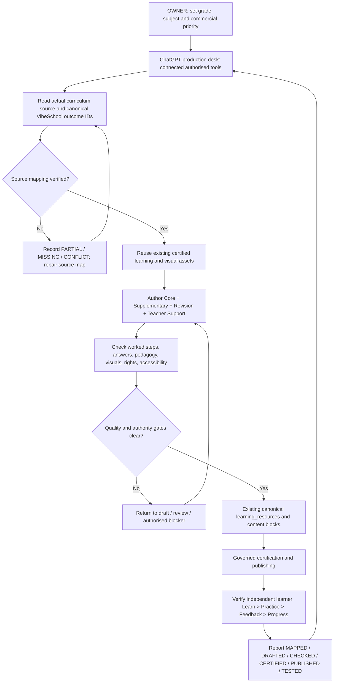

# VibeSchool Content Factory — ChatGPT-Operated, HQ-Optional

**Owner decision:** 14 November 2026  
**Scope:** Grades 1–9 (applicable CBC/CBE designs) and legacy Forms 1–4 (applicable 8-4-4 designs). These are separate curriculum systems.  
**Status:** Operational documentation only. No background workers, payments, content publication, or new privileges are activated by this file.

## The goal

The owner directs commercial priorities and receives concise evidence and exception reports. ChatGPT performs the routine content-HQ *work* through connected, authorised tools. The owner does not log into HQ to copy/paste content, fill forms or inspect every batch. HQ remains an optional protected dashboard, not an alternative source of truth or a bypassable permission gate.

A one-day sprint can inventory 13 grade/form levels, generate a substantial evidence-labelled draft queue and publish only already-cleared candidate packages. It cannot promise to finish and educationally certify every subject or lesson. Never advertise an index as a completed textbook.

## Visual pipeline

## One-day production sprint — working plan, not a completion guarantee

| Hour | ChatGPT operation | Evidence delivered |
| --- | --- | --- |
| 1 | Read existing source editions, canonical subject register, outcome coverage and stored content across all levels | Coverage ledger with known / unknown gaps |
| 2 | Prioritise missing subjects and outcomes; reuse certified resources; group safe batches | Scoped queue with source IDs |
| 3–5 | Author original outcome packages in parallel *where supported by available active tools*; include relevant diagrams and assessment feedback | Versioned candidate drafts; not falsely marked live |
| 6 | Check factual accuracy, worked mathematical steps, answers, pedagogy, accessibility and rights; route independent checks | Item-level pass/fail and repair evidence |
| 7 | Carry out authorised existing canonical publication operations on independently cleared candidates | Real publication receipts, or typed blockers |
| 8 | Read back content from teacher and independent learner routes and verify practice, feedback, progress | Real learner delivery evidence and next queue |

## Outcome package contract

For each verified outcome, store original learner explanation; appropriate worked examples with reasons; practical/guided and independent activities; assessment questions with verified answers/explanations; misconception correction; revision and differentiated support; teacher-facing guidance; and reusable diagrams/visuals where pedagogically needed. Not every optional resource type applies to every subject. Preserve source locators, stable outcome IDs, and canonical linkage to Schemes and teacher resources.

Keep one authoritative library, not a parallel ChatGPT/HQ library. Existing `learning_resources`, immutable `learning_resource_versions`, `content_blocks`, outcome links, question bank and publisher contracts retain authority.

## Status and decision discipline

- **MAPPED:** exact source-design version and curriculum outcome have been reconciled.
- **DRAFTED:** candidate original package exists; not assumed educationally correct.
- **EDITORIALLY_CHECKED:** stated checks actually executed; not independent certification.
- **CERTIFIED:** existing applicable independent quality and safety gates passed.
- **PUBLISHED:** authoritative release completed and recorded; a merged PR alone is not publication.
- **LEARNER_TESTED:** published content opened and worked for the actual target independent learner journey.

Count each stage separately by system/grade/subject/outcome. Never infer full content coverage from a curriculum index, manuscript count, AI output count or deployment.

## ChatGPT operational contract

1. Use current verified sources and read the current repo/DB first; no invented KICD outcome IDs, subjects, citations or publication receipts.
2. Act through current authorised tool connections for content auditing, drafting, integration and testing. HQ is not mandatory for routine editorial work.
3. If the only protected publishing path requires owner HQ authority not exposed to tools, record **BLOCKED_AUTHORITY**. Continue all non-blocked batches; never impersonate an owner or weaken RLS.
4. Preserve Cyborg-owned mission, exact-head, scope-lease, test, independent assurance, security, publication and release gates. A standing instruction to handle HQ tasks does not grant those powers.
5. No background generation is implied by chat. Persistent/scheduled activity requires an independently configured and approved automation or worker commissioning.
6. Report what was *actually* completed per batch and the next highest-value gap; ask the owner only for a genuinely required commercial or protected authorization decision.
7. Prioritise selling a complete, verified learner journey in a few real subjects before advertising comprehensive Grade 1–Form 4 content.

## Owner-facing report (no HQ login required)

| System | Grade/Form | Subject | Source outcomes | Mapped | Drafted | Checked | Certified | Published | Learner-tested | Blocker |
| --- | --- | --- | ---: | ---: | ---: | ---: | ---: | ---: | ---: | --- |
| CBC/CBE or legacy 8-4-4 | Actual level | Actual subject | Verified count or UNKNOWN | Actual | Actual | Actual | Actual | Actual | Actual | Typed reason |

Return real counts only after checking current canonical evidence. Do not fill this table with fabricated percentages.

## Supporting existing contracts

- [Single Content Generation Playbook](./CONTENT_GENERATION.md)
- [Content Production Operating Model](./CONTENT_OPERATING_MODEL.md)
- [Content Production Standard](./CONTENT_PRODUCTION_STANDARD.md)
- [Content Package Template](./CONTENT_PACKAGE_TEMPLATE.md)
- [HQ Coverage Read Model](../hq/CURRICULUM_CONTENT_COVERAGE.md)
- [Repository Agent Governance](../../AGENTS.md)

This document specifies a workflow, not a new runtime, authorisation path or release engine.
